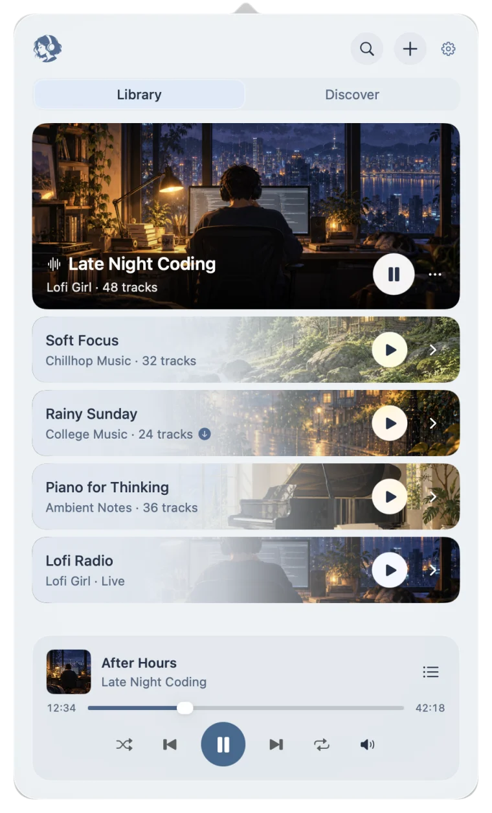
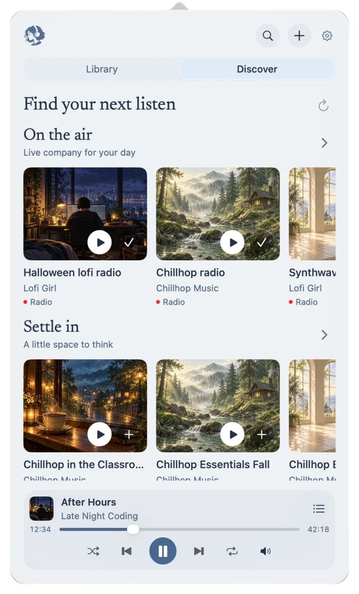

  

<h1 align="center">geet</h1>

Background music. Made for your Mac.

  <a href="https://github.com/ArsalanDotMe/geetapp/releases/latest/download/geet-apple-silicon.dmg">Download for Apple silicon</a> ·
  <a href="https://geet.mashaltech.ee">Website</a> ·
  <a href="https://github.com/ArsalanDotMe/geetapp/releases/latest">Release notes</a>

geet is a macOS menu bar player for YouTube playlists, long mixes, and live radio. Put something on, close the panel, and get back to your day.

Requires an Apple silicon Mac running macOS 26 or later.

## A look inside

  <picture>
    <source media="(prefers-color-scheme: dark)" srcset="website/assets/library-dark.webp">
    
  </picture>
  &nbsp;&nbsp;
  <picture>
    <source media="(prefers-color-scheme: dark)" srcset="website/assets/discover-dark.webp">
    
  </picture>

- **Your own library.** Add a public or unlisted YouTube playlist or video. Resume where you left off.
- **Something new to play.** Browse curated playlists, mixes, and live radio in Discover. Preview a pick before saving it.
- **A familiar way to listen.** Play, pause, skip, seek, shuffle, and repeat. Your Mac's media keys work too.
- **One click away.** Keep music playing in the background, with controls in your menu bar.
- **No account or ad breaks.** Stream without a geet account, YouTube sign-in, or interruptions from ads.

Streaming is free.

## Light on your Mac

geet plays the audio without keeping a video player or browser tab open. Its native interface stays out of the way, and background activity winds down when you aren't listening.

It's designed to keep memory use and battery impact low through long listening sessions.

## Get started

1. [Download the latest release](https://github.com/ArsalanDotMe/geetapp/releases/latest/download/geet-apple-silicon.dmg).
2. Open the DMG and drag geet to Applications.
3. Open geet and click the Listener icon in your menu bar.
4. Choose something in Discover, or use **+** to add your own YouTube link.

## Your library stays with you

Your library and listening history stay on your Mac. geet has no analytics and doesn't import browser cookies. It contacts YouTube to play your links and fetch artwork, and checks for updated Discover selections online.

## Open source

geet's code is [MIT licensed](LICENSE). Bundled tools, fonts, and third-party artwork retain their own licenses; see the [third-party notices](THIRD_PARTY_NOTICES.md).

For building or contributing, see the [development guide](docs/development.md). Maintainers can find the [release process](docs/releasing.md) separately.
